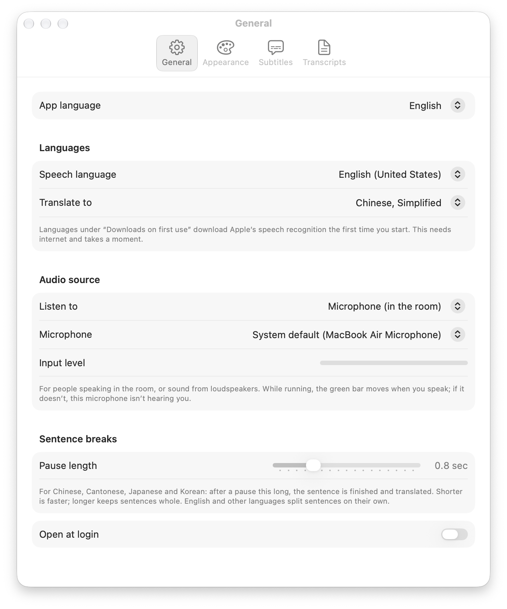

# Mic Subtitles

Live subtitles and translation for macOS, from your microphone or from whatever your Mac is playing. Speech recognition and translation run on your Mac with Apple's Speech and Translation frameworks. Nothing is uploaded.

[中文说明](#中文说明)


## Features

- **Two audio sources.** *Microphone* for people speaking in the room or sound from loudspeakers (pick any input: built-in, headset, USB, iPhone). *Mac audio* for videos, online classes and meetings, which works even when the Mac is muted.
- **Many languages.** 45 speech languages and 26 translation languages from Apple (counted on macOS 27). A language downloads the first time you use it. You can also show the original only.
- **Fast translation.** A preview translation appears while someone is still speaking. The final translation follows about 0.1 s after each sentence, using Apple Translation's low-latency mode.
- **Floating subtitle bar.** Borderless and always on top. Drag it to move it, drag an edge to resize it, and scroll back through the session with a "Latest" button to jump back. Lock it to let clicks pass through.
- **Transcripts.** Each session is saved as `…-transcript.txt` (original) and `…-translation.txt` (translation), line by line. Sessions where nothing was recognized aren't saved. No audio is ever recorded.
- **Menu bar app.** No Dock icon. The interface is in English or Chinese.

## Requirements

- macOS 26 or later on Apple Silicon (tested on macOS 27).
- To build: Xcode Command Line Tools (`xcode-select --install`). Full Xcode isn't needed.

## Install

**Download:** get the zip from [Releases](../../releases), unzip it and move `Mic Subtitles.app` to Applications. The app is ad-hoc signed (not notarized by Apple), so macOS may refuse to open it at first. If it does, run:

```bash
xattr -dr com.apple.quarantine "/Applications/Mic Subtitles.app"
```

**Or build it yourself:**

```bash
git clone https://github.com/zejuh/mic-subtitles.git
cd mic-subtitles
./build.sh install
```

## Use

1. Click the captions icon in the menu bar and choose **Start**. The first time, macOS asks for microphone access, or for permission to record system audio if you chose *Mac audio*.
2. From the same menu, choose the **Source**, the **Speech** language and **Translate to**.
3. **Settings…** has the interface language, microphone, pause length, fonts and colors, subtitle bar options and the transcripts folder (default `~/Documents/Subtitles`).



After an update (a new build), macOS may ask for the permissions again.

## Privacy

Audio, text and translations are processed only on your Mac. The app has no network code of its own. macOS downloads speech-recognition files from Apple the first time you use a speech language. Transcripts stay in the folder you choose.

## Development

| File | What it does |
|---|---|
| `Sources/App.swift` | Menu bar menu, settings window, alerts |
| `Sources/Captioner.swift` | Audio input, Apple SpeechAnalyzer, translation, transcripts |
| `Sources/SystemAudio.swift` | Capturing Mac audio with a Core Audio process tap |
| `Sources/AudioDevices.swift` | Microphone list |
| `Sources/Overlay.swift` | Floating subtitle bar |
| `Sources/SettingsView.swift` | Settings pages |
| `Sources/Preferences.swift` | Saved settings |
| `Sources/Languages.swift` | Language lists and names |

`./build.sh` builds into `build/`, `./build.sh install` also installs it, and `./build.sh zip` packages a release zip. Test options: `--test-file <audio>` feeds an audio file instead of the microphone and quits when it ends (make one with `say -o test.aiff "Hello"`); `--settings general|appearance|overlay|transcripts` opens a settings page; `MICSUB_TRACE=1` prints timing.

Notes for contributors:
- With Command Line Tools only, the SwiftUI `@State` macro isn't available, so view state lives in `@Observable` classes.
- Code comments are in Chinese.

## Credits

Inspired by [OST — On-Screen Translator](https://github.com/9bow/OST) (MIT), which subtitles the audio a Mac plays. Mic Subtitles adds the microphone as a source.

## License

[MIT](LICENSE)

---

## 中文说明

Mic Subtitles（中文系统里显示为「麦克风字幕」）是一个 macOS 实时字幕和翻译小工具。声音可以来自麦克风，也可以来自电脑正在播放的声音。识别和翻译都用苹果自带的功能，在你的 Mac 上完成，不上传。

**功能**
- **两种声音来源：**
  - 麦克风：现场讲话、扬声器放出来的声音。可以选内置、耳机、USB、iPhone 麦克风。
  - 电脑播放的声音：视频、网课、会议。Mac 静音时也能用。
- **语言多：** 45 种说话语言、26 种翻译语言，第一次用某种语言时自动下载。也可以只出原文、不翻译。
- **翻译快：** 讲话过程中先出一版预览翻译，一句讲完约 0.1 秒出正式翻译。
- **浮动字幕条：** 没有边框，一直在最上层。可以拖动、拉边缘调大小，往上翻看之前的内容，按「回到最新」跳回。锁定后鼠标可以点穿。
- **文字记录：** 每次存两个文件，`…-transcript.txt` 是原文，`…-translation.txt` 是翻译，一行对一行。一句都没录到就不存。不录音。
- **菜单栏小工具：** Dock 里没有图标。界面可以选英文或中文。

**系统要求：** macOS 26 以上，Apple 芯片（在 macOS 27 上测试过）。

**安装：**
- 从 [Releases](../../releases) 下载 zip，解压后把 `Mic Subtitles.app` 放进「应用程序」。
- 因为没有苹果开发者签名，第一次打不开的话，在终端运行：`xattr -dr com.apple.quarantine "/Applications/Mic Subtitles.app"`
- 也可以自己编译：`./build.sh install`，只需要命令行工具，不需要装 Xcode。

**使用：**
1. 点菜单栏的字幕图标，选「开始」。第一次会问麦克风权限；选了「电脑播放的声音」的话，会问要不要允许录制系统声音。
2. 在同一个菜单里选声音来源、说话语言、翻译成。
3. 字号、颜色、字幕条、保存位置（默认 `~/Documents/Subtitles`）、界面语言都在「设置」里。

参考了 [OST](https://github.com/9bow/OST)（MIT）。许可证：MIT。
